# Kiosque

Un dashboard auto-hébergé, moderne et entièrement configurable depuis la page. Aucune dépendance : un seul `server.js` (Node 20.12+) et du HTML/CSS/JS.

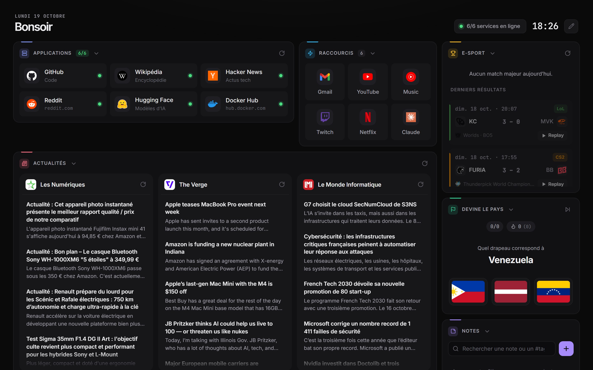

## Ce qu'il sait faire

| Section | Rôle |
| --- | --- |
| **Applications** | Liens vers tes services ou sites, en liste ou en grille d'icônes, avec pastille en ligne / hors ligne (vérifiée côté serveur, certificats auto-signés et codes HTTP personnalisés acceptés) |
| **Page intégrée** | N'importe quelle page web ou app perso dans une carte (iframe) |
| **Actualités** | Flux RSS côte à côte |
| **YouTube** | Dernières vidéos de tes chaînes, lecture dans la page |
| **E-sport** | Matchs majeurs du jour avec logos, scores et badge « En direct » (clé PandaScore) |
| **Notes** | Notes avec tags colorés et recherche, gardées dans le navigateur |
| **Devine le pays** | Quiz sur les drapeaux |

Et aussi : sections repliables, déplaçables, de largeur réglable, statut global des services en haut de page, et un affichage pensé pour le mobile.

<p align="center">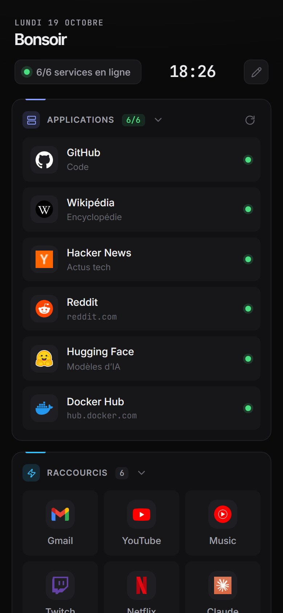</p>

## Démarrage

### 1. Lancer Kiosque

Avec Docker :

```bash
docker compose up -d --build
```

Ou directement avec Node :

```bash
node server.js
```

Puis ouvre http://localhost:3010. Au premier lancement, Kiosque part d'une configuration d'exemple (`config.default.json`).

### 2. Créer le mot de passe admin

Clique sur le **crayon** en haut à droite. La première fois, Kiosque te demande de choisir le mot de passe qui protégera le mode édition (8 caractères minimum).

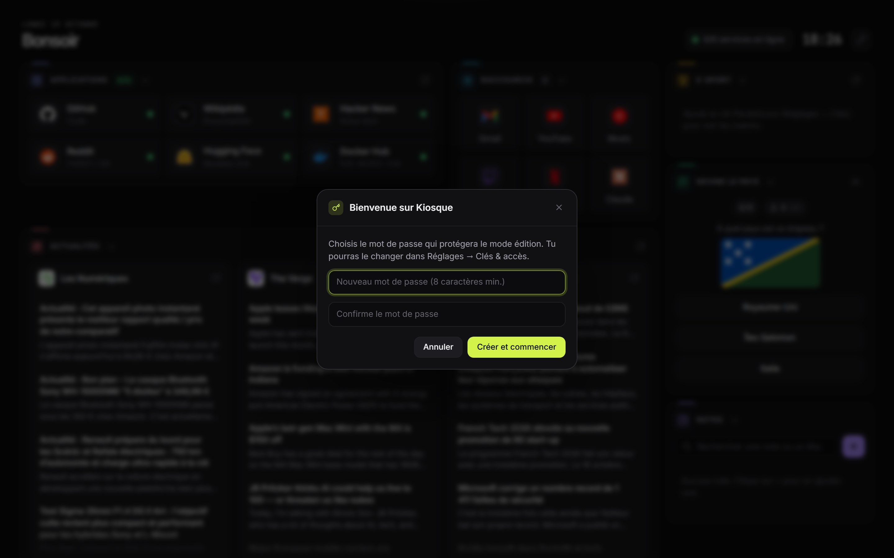

### 3. Personnaliser

Une fois connecté, tu es en **mode édition** : chaque carte a ses outils, une barre apparaît en bas de l'écran.

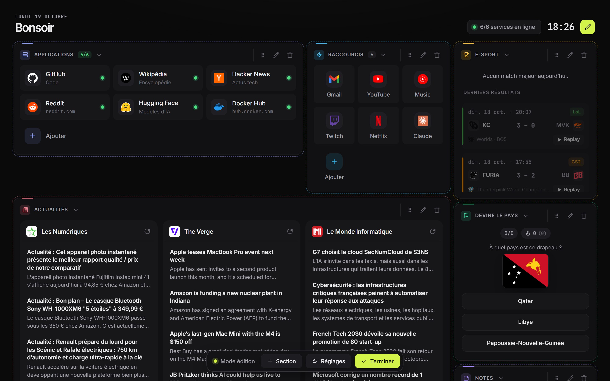

| Action | Comment |
| --- | --- |
| Ajouter une section | **+ Section** dans la barre du bas |
| Modifier une section | **crayon** de la carte : titre, icône, couleur, largeur et contenu |
| Ajouter une application | tuile **Ajouter** dans une section Applications |
| Modifier une application | clique simplement dessus en mode édition |
| Déplacer une carte | glisse la **poignée ⋮⋮** (ou flèches du clavier dessus) |
| Supprimer | **corbeille**, deux clics pour confirmer |
| Quitter le mode édition | **Terminer** (ou Échap) |

Tout est enregistré sur le serveur dès que tu cliques sur **Enregistrer**.

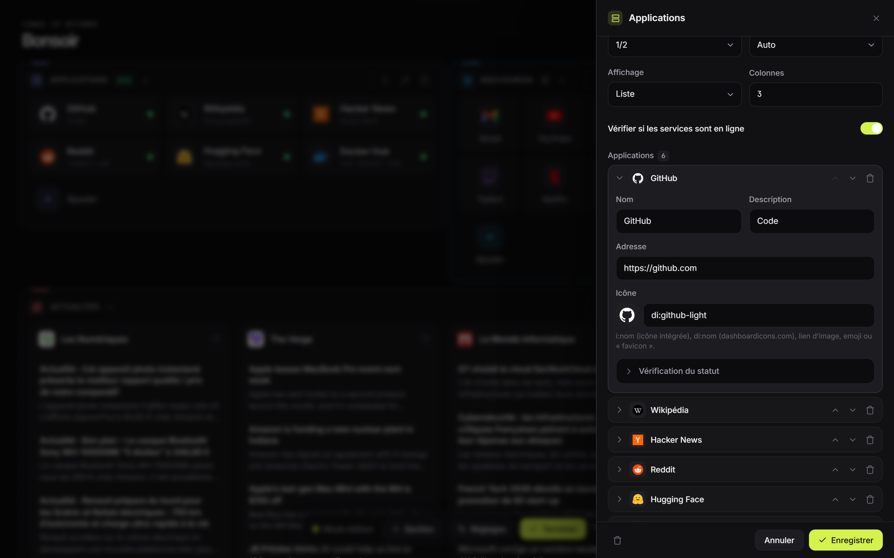

## Ajouter une section

**+ Section** ouvre la liste des types disponibles :

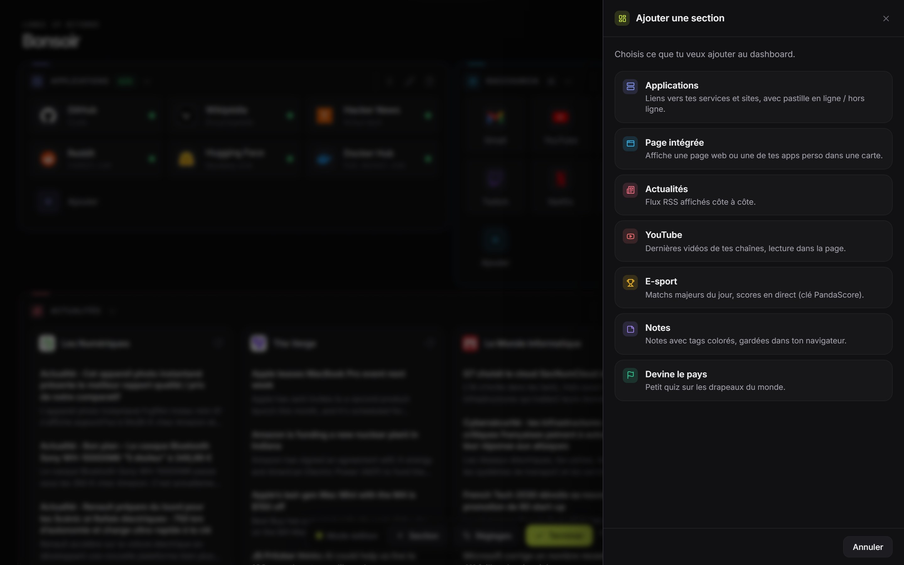

### Intégrer une app perso (iframe)

Choisis **Page intégrée**, puis indique l'adresse de ta page ou de ton app et sa hauteur. Avec « Fond transparent », la page laisse voir le fond du dashboard si elle n'a pas de fond à elle.

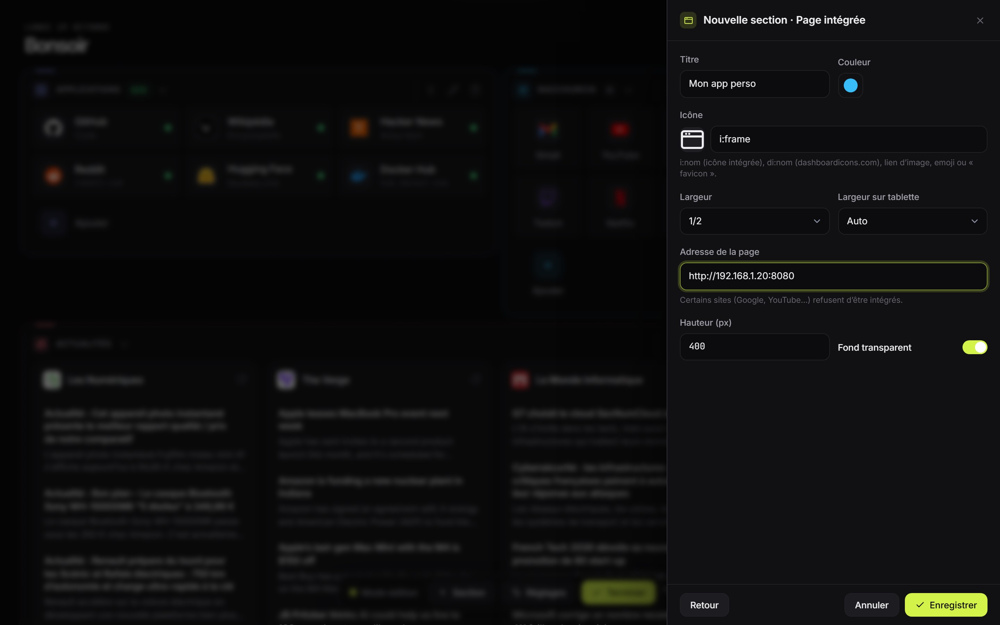

> Certains sites (Google, YouTube, la plupart des banques…) refusent d'être affichés dans une page intégrée. Et si Kiosque est servi en `https://`, les pages en `http://` seront bloquées par le navigateur.

### Icônes

Dans tous les champs « Icône » :

- `i:nom` : icônes intégrées (proposées pendant la saisie), ex. `i:server`
- `di:nom` : le catalogue [dashboardicons.com](https://dashboardicons.com), ex. `di:portainer`, `di:jellyfin`
- un lien d'image, un emoji, ou `favicon` pour l'icône du site

### Chaînes YouTube

Colle le lien de la chaîne ou son `@pseudo` : l'identifiant est retrouvé tout seul.

## Thèmes

Trois thèmes au choix, dans **Réglages → Général**. Un clic donne l'aperçu immédiat, **Enregistrer** le garde.

| Graphite (par défaut) | Aurore | Papier |
| --- | --- | --- |
| 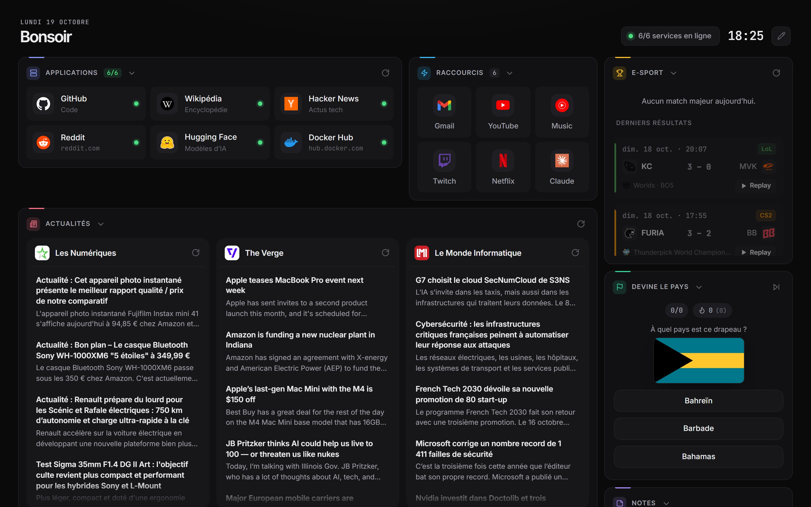 | 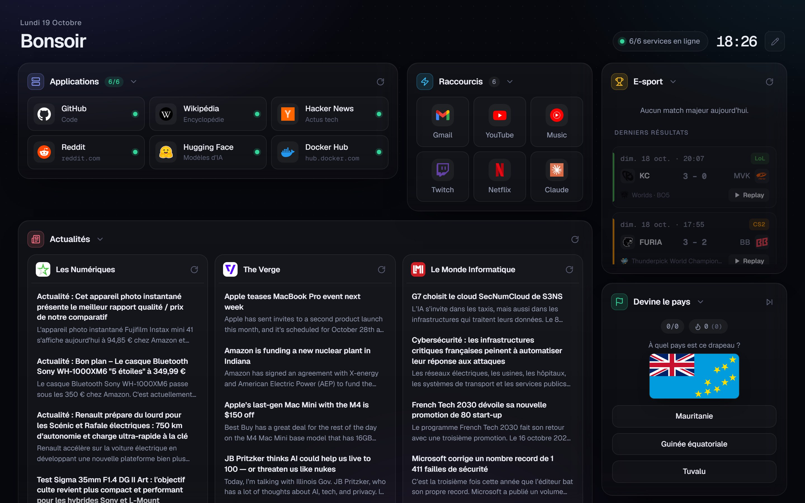 | 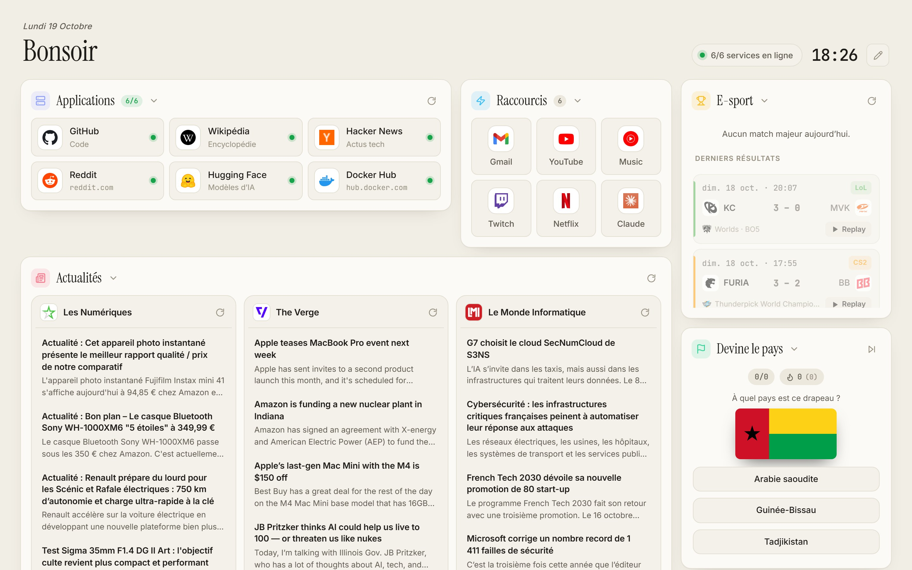 |
| Sombre, plat et dense, accent citron vert | Sombre, reflets bleutés, cartes en verre | Clair, titres éditoriaux en serif |

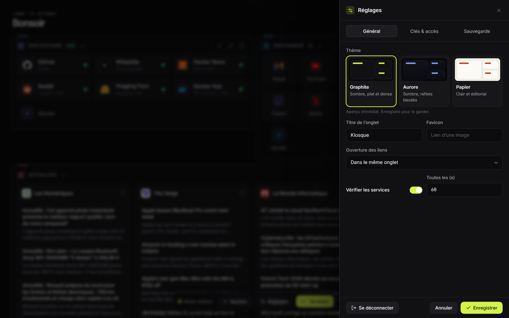

Les cartes se rangent toutes seules : chacune garde la hauteur de son contenu et les plus petites viennent combler les trous.

## Réglages

Le bouton **Réglages** de la barre d'édition a trois onglets : **Général** (thème, titre, ouverture des liens, vérification des services), **Clés & accès** et **Sauvegarde**.

### Clés & accès

C'est ici que se règlent les clés API des widgets et le mot de passe admin, sans toucher au serveur. Les clés sont gardées sur le serveur (`data/secrets.json`) et ne sont jamais renvoyées en clair à la page. La clé PandaScore est aussi modifiable directement depuis le formulaire d'une section e-sport.

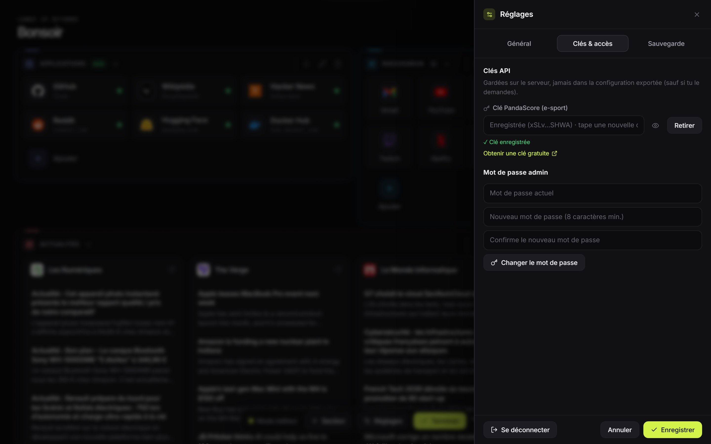

| Clé | Pour quoi | Où l'obtenir |
| --- | --- | --- |
| Clé PandaScore | Sections e-sport | Gratuite sur [app.pandascore.co](https://app.pandascore.co) |

### Sauvegarde : enregistrer et charger une configuration

- **Télécharger ma configuration** : enregistre toute la config (sections, applications, flux, chaînes…) dans un fichier `.json`. Coche « Inclure les clés API » pour emporter aussi la clé PandaScore.
- **Charger une configuration** : glisse un fichier `.json` dans la zone (ou clique pour le choisir). Kiosque affiche son contenu avant de remplacer quoi que ce soit.

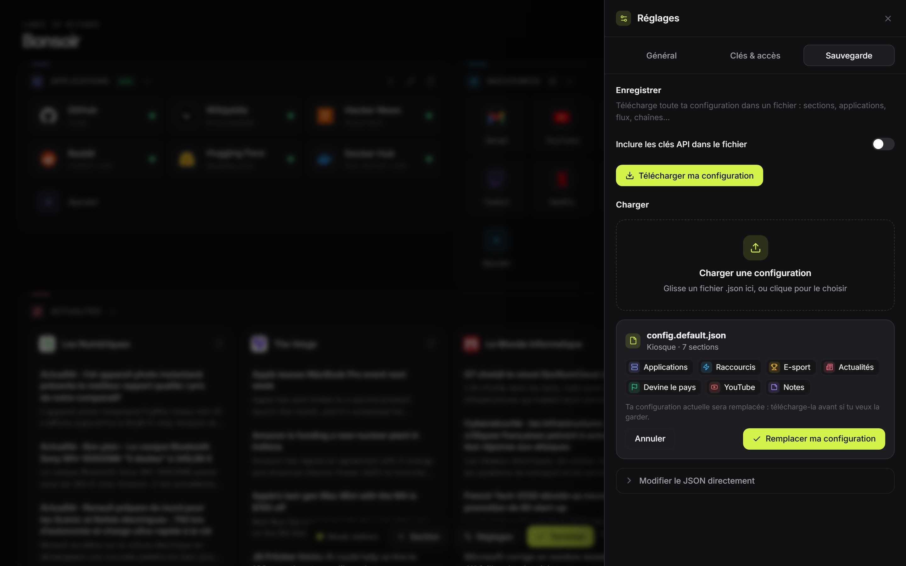

C'est la façon la plus simple de passer ta configuration d'un serveur à un autre, ou de garder une sauvegarde.

## Déployer avec Portainer

1. Portainer → **Stacks** → **Add stack**, nom `kiosque`, méthode **Repository**.
2. Repository URL : l'adresse de ce dépôt. Reference : `refs/heads/main`. Compose path : `docker-compose.yml`.
   Dépôt privé : active **Authentication** (nom d'utilisateur GitHub + *personal access token*).
3. Facultatif, dans **Environment variables** : `KIOSQUE_PORT` pour choisir le port de ton serveur (ex. `3000`, sinon `3010`), et les clés listées plus bas.
4. **Deploy the stack**, puis ouvre `http://<ip-du-serveur>:<port>`.
5. Crée ton mot de passe au premier clic sur le crayon, puis charge ta configuration depuis **Réglages → Sauvegarde**.

> Le port choisi doit être libre (un autre conteneur ne doit pas déjà l'utiliser) et ouvert dans le pare-feu du serveur.

La config et les clés sont gardées dans le volume `kiosque-data` : elles survivent aux mises à jour. Pour mettre à jour le code : pousse sur GitHub, puis **Pull and redeploy** dans la stack.

> Sur un serveur accessible depuis Internet, crée le mot de passe admin dès le premier lancement : tant qu'il n'existe pas, le premier visiteur peut le choisir. Pour l'imposer à l'avance, utilise la variable `ADMIN_PASSWORD` ci-dessous.

## Variables d'environnement (facultatives)

Tout se règle dans la page, mais tu peux aussi tout fixer côté serveur. Une variable définie a la priorité sur la page, et n'y est alors plus modifiable.

| Variable | Rôle |
| --- | --- |
| `ADMIN_PASSWORD` | Mot de passe du mode édition |
| `PANDASCORE_TOKEN` | Clé API PandaScore pour l'e-sport |
| `KIOSQUE_PORT` | Avec Docker : port du serveur où Kiosque est accessible, `3010` par défaut |
| `PORT` | Sans Docker : port d'écoute de `node server.js`, `3010` par défaut |
| `DATA_DIR` | Dossier de la config et des clés, `data` par défaut (`/app/data` dans Docker) |

En local ou avec Docker Compose, mets-les dans un fichier `.env` (copie de `.env.example`). Dans Portainer, ajoute-les dans **Environment variables** de la stack.

## Configuration en JSON

Tout ce que fait l'éditeur est enregistré dans `data/config.json`, qu'on peut aussi modifier à la main (ou depuis **Réglages → Sauvegarde → Modifier le JSON directement**) :

```jsonc
{
  "title": "Kiosque",
  "theme": "graphite",         // ou "aurore", "papier"
  "openIn": "sametab",          // ou "newtab"
  "statusCheck": true,
  "statusInterval": 60,         // secondes
  "sections": [
    {
      "name": "Applications",
      "type": "links",          // links, iframe, rss, youtube, esport, notes, flags
      "icon": "i:server",
      "tint": "#8b9cff",
      "span": 6,                // largeur sur 12 colonnes
      "items": [
        { "title": "Portainer", "url": "https://192.168.1.10:9443", "icon": "di:portainer", "allowInsecure": true }
      ]
    },
    { "name": "Mon app", "type": "iframe", "url": "http://192.168.1.10:8080", "height": 400, "span": 6 }
  ],
  "secrets": { "pandascoreToken": "…" }   // facultatif : enregistré à part au chargement du fichier
}
```

Les options de chaque type sont visibles dans l'éditeur, ou décrites dans `public/schema.js`.

## À savoir

- Les notes et le record du quiz sont propres à chaque navigateur.
- Le dossier `data/` et les fichiers `ma-config*.json` sont exclus de Git : ils contiennent ta configuration et tes clés.
